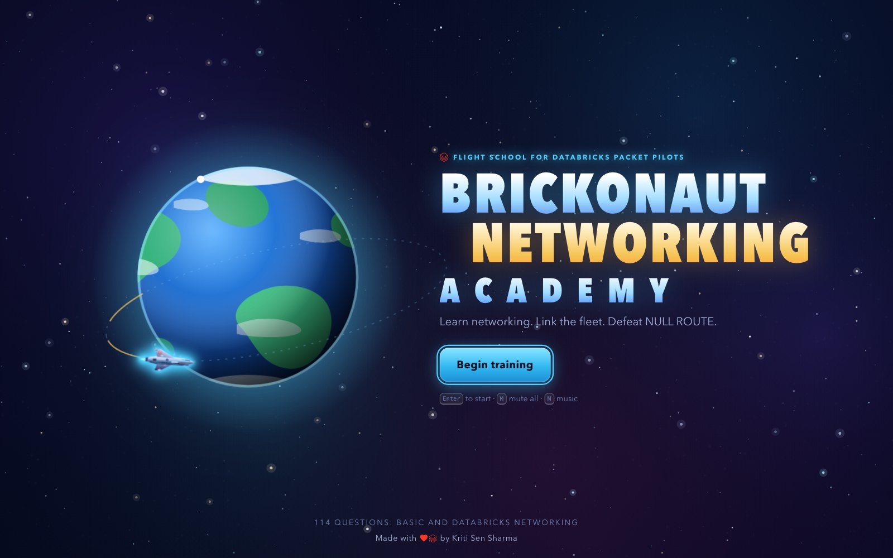
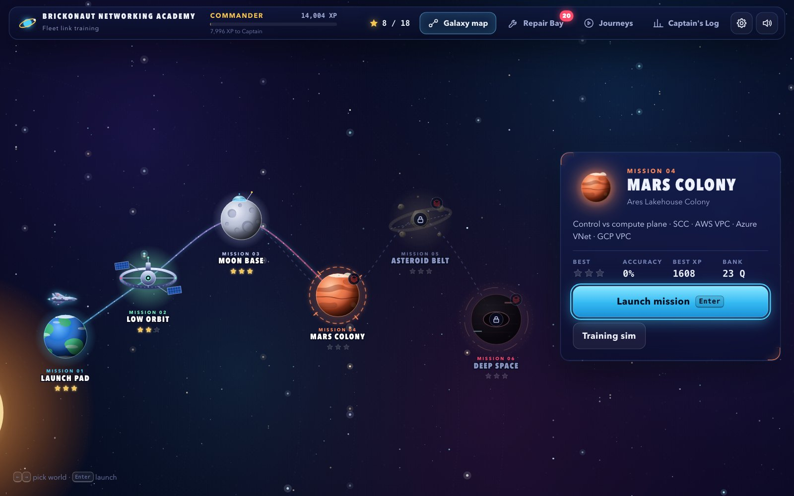
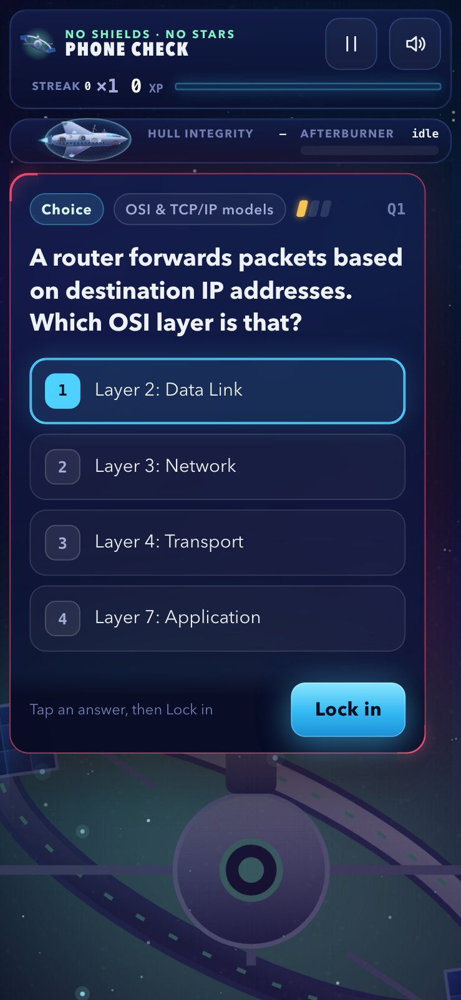
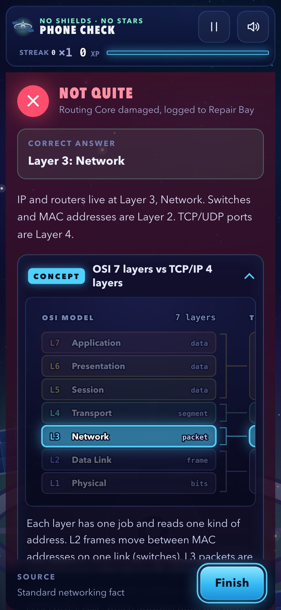
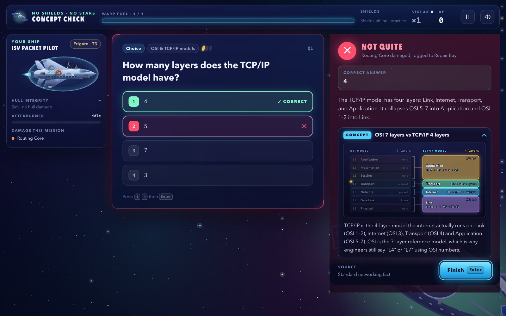
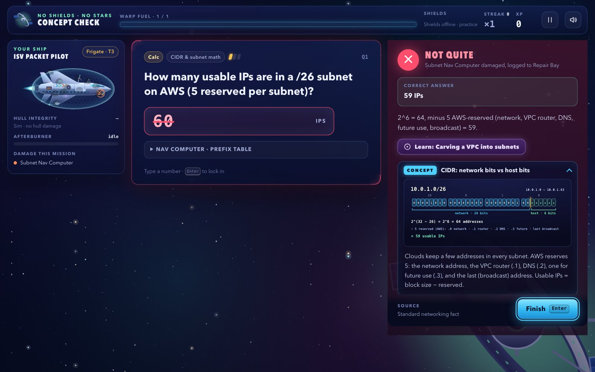
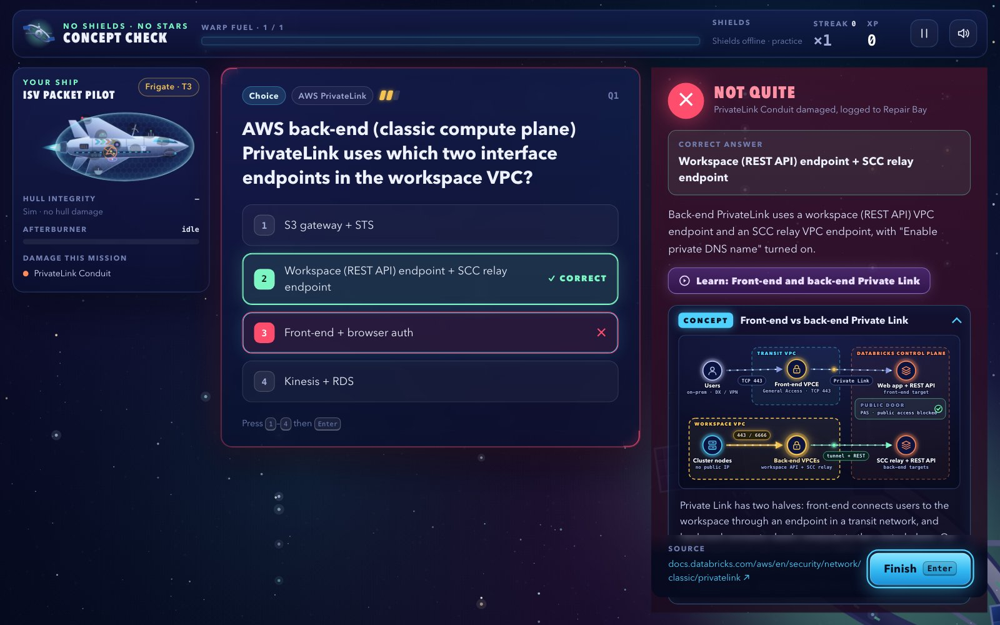
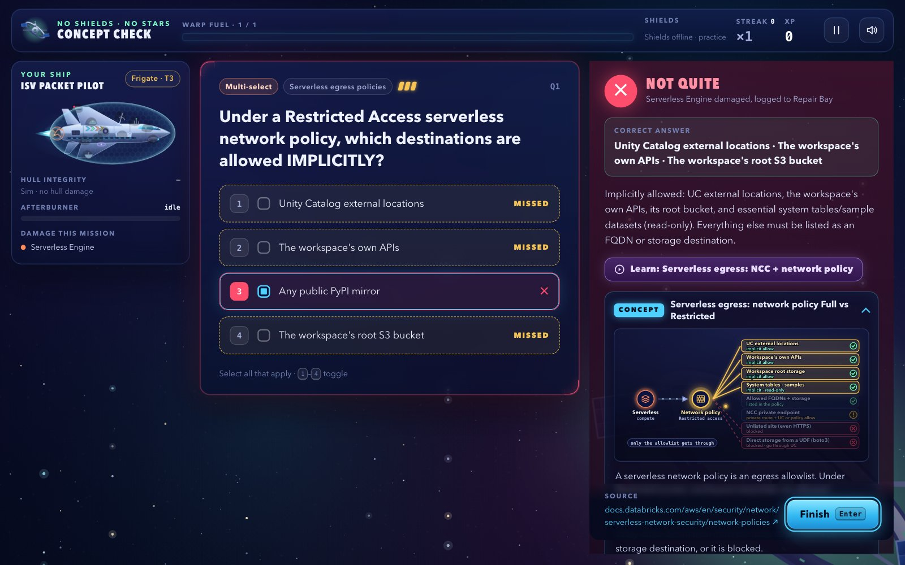
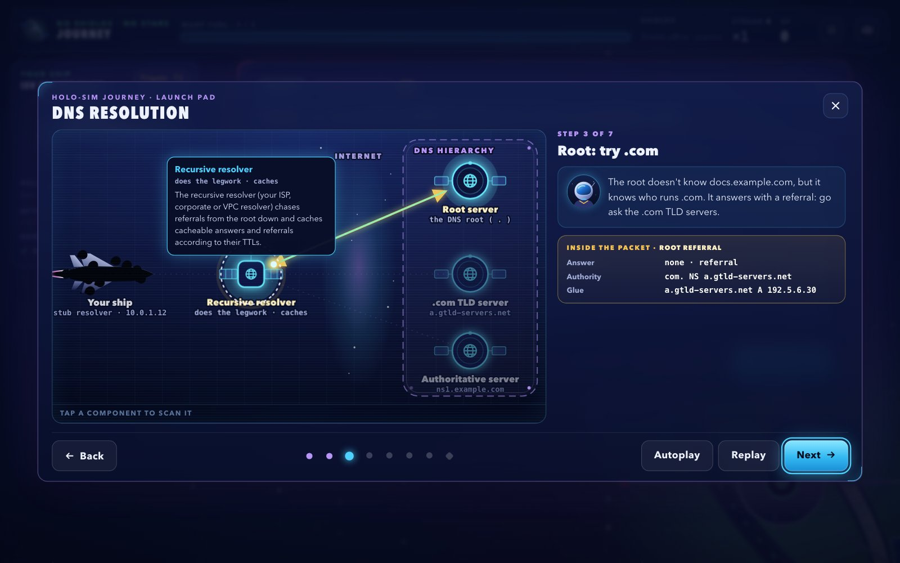
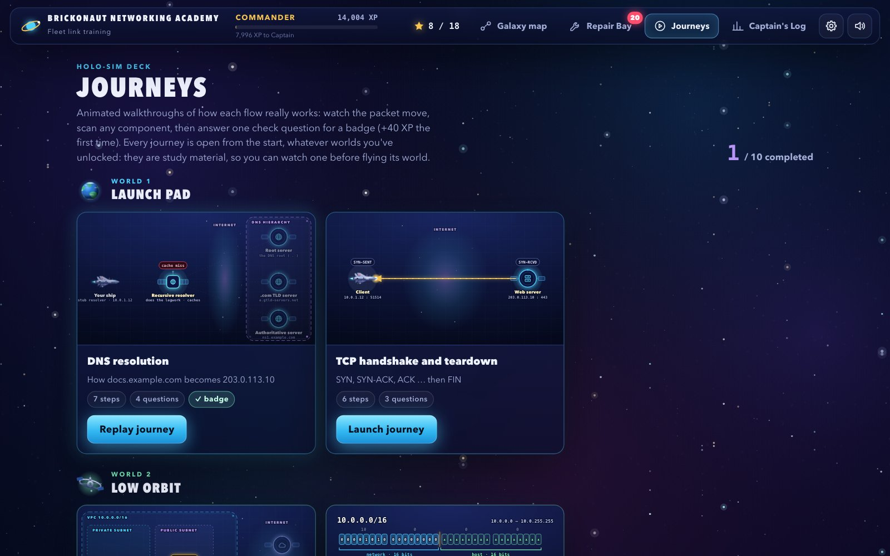

# Orbital Network Academy

A space-themed trainer for general networking fundamentals, built to learn cloud and Databricks networking. You play a cadet linking humanity's lakehouse fleet across the solar system while a rogue AI, **NULL ROUTE**, cuts the links. You learn by flying missions, the Repair Bay drills what you missed, and the Captain's Log tracks how you improve.

**Play online:** https://kritisen.github.io/orbital-network-academy/





## Launch

Open `index.html` in a browser. You can double-click it, since it runs straight from `file://`. There's no build step, server, network access, or dependency. It works offline in Chrome, Safari, Edge, and Firefox on a laptop, an iPad or a phone.

Progress saves to `localStorage` in that browser.

### On a phone

The game also plays on phones, in portrait and landscape. Everything is tap-sized (44 px targets), and keyboard hints are swapped for tap wording on touch screens. The galaxy map pans sideways above a compact mission card. In a mission, a two-row HUD and a slim ship strip sit above the question, and **Lock in** sticks to the bottom of the screen. Sequence steps get larger ▲/▼ buttons and still drag with a finger. Diagram questions and concept figures scroll sideways inside their frame rather than shrinking to unreadable text. A focused number field scrolls clear of the on-screen keyboard. Journeys stack in portrait (turn the phone sideways for a bigger holo-sim) and sit side by side in landscape.

| | |
|---|---|
|  |  |

## How to play

| Thing | What it does |
|---|---|
| **Galaxy map** | Pick a world with a click or <kbd>←</kbd>/<kbd>→</kbd>, then press <kbd>Enter</kbd> to launch. Your ship flies between planets. |
| **Missions** | Each world has a commander briefing, 12 questions ordered easy to hard (the boss uses all 15 scenarios), a mid-mission twist that turns on **Overdrive** (×1.5 XP), and an outro. |
| **Shields / hull** | They act as lives: 3 per mission, 5 for the boss. A wrong answer or wrong scenario step costs a hull point, and every streak of 5 restores one. The ship's shield bubble fades as you lose points. At 0 the ship powers down and is towed to the Repair Bay. |
| **XP and streaks** | Base XP depends on difficulty. A streak multiplies it ×1.5 after 3 in a row, ×2 after 6, and ×3 after 10. Answers under 20 s earn a speed bonus. Rank goes from Cadet up to Fleet Admiral. |
| **Stars** | 3★ needs ≥90% accuracy, 2★ ≥75%, 1★ ≥50%. **2★ unlocks the next world.** Turn on *Settings → Free roam* to skip the gating. |
| **Boss: Deep Space** | Multi-step architecture and troubleshooting scenarios on a 15-minute clock. The clock pauses while the game is paused. |
| **Training sim** | Ten random questions from one world, with no shields or stars and half XP. |
| **Repair Bay** | The hangar where your ship is docked. Every damaged module is labelled on the ship. Underneath, it's Leitner spaced repetition. Any miss goes to bay 1. A correct answer moves a part up a bay **only once its review is due** (review intervals: now, 4 h, 1 d, 3 d, 7 d), and clearing bay 5 marks it repaired. Another miss sends it back to bay 1. *Start repair run* serves the due parts. *Drill all damaged* is practice: early hits don't skip bays. |
| **Captain's Log** | Accuracy is credit earned ÷ graded attempts, and multi-part scenarios earn partial credit per step (2 of 3 = 0.67). Shows overall KPIs, a radar of accuracy by sector, the accuracy trend over sessions, your weakest 5 topics (each with a **Drill** button), accuracy per topic, time per question by type, and best scores. **Export JSON**, **Import JSON**, and **Reset** are here too. |

**Question types:** multiple choice, multi-select, numeric calculations (CIDR math, node sizing), sequence ordering (drag, or use <kbd>1</kbd>–<kbd>9</kbd> plus <kbd>↑</kbd>/<kbd>↓</kbd>), diagram questions where you click the broken component, and multi-part scenarios. Numeric CIDR questions include a collapsible "Nav computer" prefix table. Every answer shows an explanation, a **Concept** figure (below), and a **Source** link to the Databricks docs page the fact was checked against.

**Concept figures.** Every question (all 114) has an animated concept figure and a 1–3 sentence concept text. The concept text teaches the idea underneath the question, separately from the answer-specific explanation. The part that matters is highlighted: the right layer, record, port, route, hop, or the failing component. After a **wrong** answer the Concept block opens automatically. After a right answer it's collapsed, one click (or <kbd>Enter</kbd> on it) away. It works the same in missions, training sims and Repair Bay runs. Multi-part scenarios can switch figure per step: for example, the Azure 500-node sizing scenario shows the bit split for steps 1–2 and the VNet carve-up for step 3. The library has 34 figures, including OSI vs TCP/IP, the DNS record types, DNS resolution, CNAME chains and split horizon, port badges, CIDR bit splits with each cloud's reserved IPs, route tables with longest-prefix match, NAT/PAT, stateful vs stateless filtering, TLS, L4/L7 load balancers, proxies, hybrid links, endpoint types, control vs compute planes, SCC, AWS/Azure/GCP customer-managed networks, front-end vs back-end Private Link (per cloud), ingress controls, NCC, serverless network policies, Azure NAT Gateway vs a UDR to Azure Firewall, the storage firewall/NSP, and troubleshooting ladders.



| | |
|---|---|
|  |  |
|  | |

**Journeys (holo-sim).** A journey is an animated, clickable walkthrough of how a flow actually works, played in a full holo-sim overlay. Your ship is the client, servers are stations and satellites, the internet is a nebula, and a VPC/VNet or Databricks account is a station ring. Each step sends a glowing packet between the components involved, with Commander Vega narrating and an **Inside the packet** callout (fields like source/destination, flags, TTL, the route that matched). Tap or click any component, or Tab to it and press <kbd>Enter</kbd>, to scan it and get a tooltip. Controls are Back/Next, progress dots (jump to any step), **Autoplay**, **Replay** and <kbd>Esc</kbd>. On the keyboard: <kbd>←</kbd>/<kbd>→</kbd> step, <kbd>Space</kbd> or <kbd>P</kbd> autoplay, <kbd>R</kbd> replay, <kbd>1</kbd>–<kbd>4</kbd> answer. Each journey ends with one **check yourself** question. Answering it correctly earns a holo-sim badge, plus **+40 XP the first time** (replays are logged but earn no XP). While a journey is open, the boss clock is frozen.

| Journey | World | Questions mapped |
|---|---|---|
| DNS resolution (stub → recursive resolver → root → .com TLD → authoritative → cached for the TTL, plus the cached shortcut) | 1 | 4 |
| TCP handshake and teardown (SYN / SYN-ACK / ACK, data + ACKs, FIN/ACK ×2, TIME-WAIT) | 1 | 3 |
| Leaving a private subnet through NAT (route lookup, SNAT + PAT, IGW, reply via the table, unsolicited inbound dropped) | 2 | 5 |
| Carving a VPC into subnets (bit split, /16 → /20 → /24, AWS node sizing, two AZs, Azure/GCP reserved IPs) | 2 | 15 |
| TLS 1.3 handshake (ClientHello with SNI + key share, ServerHello, certificate + CertificateVerify, validation, mTLS and TLS inspection) | 3 | 4 |
| An HTTP request through a load balancer (TLS termination, path rules, X-Forwarded-For, reverse proxy, L4 vs L7) | 3 | 4 |
| A classic cluster starts (control plane → your cloud API, no inbound, outbound 443 to the SCC relay, instructions over the tunnel, data stays in your storage) | 4 | 5 |
| Azure NAT Gateway vs a UDR to Azure Firewall (automatic exit, no filtering, UDR to the virtual appliance, FQDN allow/deny, the "Internet" next-hop pitfall) | 4 | 2 |
| Front-end and back-end Private Link (privatelink CNAME, transit VPC endpoint, PAS, back-end workspace + relay endpoints on 443/6666, Azure equivalents) | 5 | 13 |
| Serverless egress: NCC + network policy (Full vs Restricted, implicit UC allow, listed FQDN, unlisted blocked/dry-run, NCC private endpoint still needs a UC/policy allow, boto3-in-UDF blocked) | 5 | 8 |

There are three ways in:
- **Learn: &lt;journey&gt;** in the feedback panel of every mapped question (63 of 114).
- **Watch the journey first** on mapped sequence questions, *before* you answer (5 of the 6 order questions). This counts as a hint and is tracked per journey. The game has no hint penalty, so it costs nothing.
- The **Journeys** library in the top bar, grouped by world. Each card shows a live thumbnail, the step and question counts, and a ✓ badge once you've completed it.

All journeys are open from the start, whatever worlds you've unlocked. They're study material, and gating them behind quiz stars would stop you watching one *before* you fly its world, which is exactly when it helps most. The Captain's Log has a **Holo-sim journeys** card with completed / total, a per-journey status (runs, first try) and Replay buttons. With reduced motion on, journeys show each step's end state: the trail is already drawn and the packet sits at its destination, with no travelling probes or pulses.





Figures are `aria-hidden` (decorative); the concept text is plain text that screen readers read. With reduced motion on, figures are static: no travelling probes or flowing packets, and everything is revealed at once. The Continue button sticks to the bottom of the feedback panel, so a tall figure scrolls inside the panel instead of pushing Continue off-screen (desktop, iPad landscape and portrait).

**Keyboard:** <kbd>1</kbd>–<kbd>9</kbd> picks an answer, <kbd>Enter</kbd> locks in or continues, <kbd>Esc</kbd> pauses, <kbd>M</kbd> mutes all sound, <kbd>N</kbd> turns music on or off.

**Your ship.** The same inline-SVG ship appears on the title, the galaxy map, in every mission, in the debrief and in the Repair Bay hangar. It always shows your current tier.

| What you see | What it means |
|---|---|
| **Mission panel** (left column on desktop; a strip above the question on iPad) | Hull integrity (= lives), the shield bubble, afterburner (= streak) and the modules hit this mission. The panel never covers the question. |
| **Correct answer** | Thruster boost and a shield shimmer. Streaks lengthen the engine flame, and 3+ in a row lights the afterburner and speed lines. |
| **Wrong answer** | An impact flash, a small shake (off with reduced motion), and damage on the **module for that question's topic**. One hit cracks and sparks it; a second makes it smoke. Damage accumulates through the mission. |
| **Hull at 0** | Power-down: lights flicker off, the engines die, the shield collapses and the ship tumbles under an alarm tint. Then the debrief, headed *Ship disabled*, shows the wreck. |
| **Debrief** | "N sent to Repair Bay" shows those modules taking damage, one by one. |
| **Repair Bay** | The ship docked in a hangar, with a labelled callout per damaged module (e.g. "NAT Thruster · 2 parts · bay 1"). A repair run welds the module of each question you get right. A fully repaired ship shows *All modules nominal*. |

Topic → module: DNS + hybrid DNS → DNS Antenna · TLS + proxies → TLS Comms Array · CIDR → Subnet Nav Computer · routing + OSI → Routing Core · NAT → NAT Thruster · firewalls + ingress → Firewall Shield Emitter · ports + TCP/UDP → Port & Protocol Valves · load balancing → Load-Balancer Gyro · hybrid links → Hybrid Link Dish · endpoints + all Private Link/PSC → PrivateLink Conduit · AWS/Azure/GCP VPC → VPC Hull Plating · planes + SCC → Control-Plane Reactor · serverless + egress → Serverless Engine · scenarios → Command Bridge. Topics added later land on the hull. A module's severity follows the worst Leitner bay among its questions (bay 1 smoking, 2–3 cracked, 4–5 scorched).

**Upgrades** are cosmetic and come from total stars: Scout (0★), Cutter 3★ (hull plating), Frigate 7★ (stabilizer fins), Cruiser 11★ (twin nacelles + plasma-gold engines), Flagship 15★ (gold trim, wingtip pods, ion halo). Each world cleared (1★+) adds a hull decal in its colour. The **Hangar** card in the Repair Bay shows your class, the next upgrade and what unlocks it, your decals, and how many modules you've fully repaired. The ship is decorative to screen readers; hits, welds, repairs, the power-down and upgrades are announced in a polite live region.

**Music and sound.** Everything is synthesized in the browser with WebAudio. There are no audio files, so it works offline from `file://`. The music is generated live: slow pads, a soft drone, a sparse bell melody or a gentle arpeggio, with reverb and delay. Because it's generated beat by beat, it never loops back to a seam.

| Where | Mood |
|---|---|
| Title, galaxy map, Repair Bay, Captain's Log, debrief | **Calm**: slow D-major pads and occasional bells |
| Missions, training sims, repair runs | **Focus**: A-minor pads, a soft arpeggio and a gentle pulse |
| World 6 boss | **Tension**: E-phrygian pads, a detuned drone and a heartbeat pulse |
| Clearing a level (1★ or better) | A short **victory sting**, then back to calm. Launching the next mission cuts it short. |

Moods crossfade when the screen changes. The music dips briefly under sound effects, and stays lower for a couple of seconds after a wrong answer while you read the explanation.

| Control | What it does |
|---|---|
| <kbd>M</kbd> or the speaker button | Mute all, music and effects together. Your music and SFX choices underneath are kept. |
| <kbd>N</kbd> | Music on or off. Turning music on with <kbd>N</kbd> also lifts a mute-all. |
| *Settings → All sound / Music / Sound effects* | A switch for each, plus a **volume slider** each for music and effects. |

Browsers block autoplay, so the music starts on your first click or key press (usually *Begin training*). A "Music on" toast appears once per visit. When the tab is hidden, the music fades out and audio is suspended; it comes back when you return. Settings are saved with your progress. Saves from before music existed keep their old mute setting and get music and effects switched on at the default volume.

On phones, every later tap or key press keeps trying to unlock audio until the browser actually runs it. On iPhone and iPad the game asks for a playback audio session, so the ringer/silent switch doesn't silence it. Safari 16.4+ does this through `navigator.audioSession`, set before any audio starts. Older iOS plays a looping silent `<audio>` element, but only while sound is wanted and the page is visible; it's removed on mute, when the page is hidden, or with music and effects both off. After a phone call, the lock screen or a back/forward navigation, the game resumes audio itself or on your next tap. If the browser still won't start sound about 1 s after a tap while music is on, a small **Tap for sound** chip appears under the top bar. The game never says "Music on" before audio is actually running.

**Accessibility:** contrast is tuned for a dark UI. If your OS has *reduce motion* turned on, the game respects it (no starfield motion, shake, or particles). You can override that in Settings. Reduced motion doesn't turn the music off. It softens the rhythmic pulse and the filter sweeps instead.

## Content

Questions live in data files, separate from the engine: `data/questions.js` holds worlds 1–6. The 114 networking questions come from two places: `source/networking_facts.md` (facts paraphrased from public Databricks, Microsoft, AWS and Google Cloud documentation, checked against the linked pages on 2026-11-22) and standard networking facts. Every question in a Databricks topic (`dbx-*`) carries the docs URL it was checked against and shows it as **Source** after you answer.

| World | Topics | Questions |
|---|---|---|
| 1 Launch Pad (Earth) | OSI/TCP-IP, TCP vs UDP, ports, DNS | 16 |
| 2 Low Orbit (Relay Ring) | CIDR math (AWS/Azure −5, GCP −4), routing, NAT, stateful vs stateless | 18 |
| 3 Moon Base | L4/L7 LBs, proxies, TLS, VPN/DX/ER, hub-spoke, endpoints, hybrid DNS | 18 |
| 4 Mars Colony | Control vs compute planes, SCC, AWS VPC, Azure VNet injection, GCP VPC | 23 |
| 5 Asteroid Belt | AWS PrivateLink FE/BE, Azure Private Link + browser auth, GCP PSC, NCC, network policies, IP ACLs, context-based ingress | 24 |
| 6 Deep Space (Boss) | 15 scenarios (11 multi-part, 35 graded steps) built from the worked scenarios in `source/networking_facts.md` | 15 |

## Adding questions or a level, no code changes needed

1. A level is a data file that calls `ONA.registerLevel(level, questions)`, for example a bonus world:

   ```js
   (function (root) {
     'use strict';
     root.ONA.registerLevel({
       id: 7, key: 'bonus-cidr', name: 'Bonus: Subnet Sprint', body: 'Relay Beacon', art: 'beacon',
       bonus: true, accent: '#b794f6', subtitle: 'Bonus · extra CIDR practice',
       map: { x: 1330, y: 120 },                       // in the map's 1600×900 viewBox
       briefing: [{ who: 'vega', text: 'Extra practice, Cadet. Quick subnet math.' }]
     }, [ /* question objects, see step 2 */ ]);
   })(typeof window !== 'undefined' ? window : globalThis);
   ```

   Bonus worlds don't count toward the 18-star total or the ship upgrades.
2. Add question objects, using the schema documented at the top of `data/questions.js`:

   ```js
   { id: 'b-cidr-27', topic: 'cidr', difficulty: 1, type: 'numeric',
     prompt: 'How many total addresses are in a /27?', answer: 32, unit: 'addresses',
     calc: { kind: 'total', prefix: 27 },               // optional: the validator recomputes it
     explain: '2^(32−27) = 32.' }

   { id: 'b-pl-1', topic: 'dbx-pl-aws', difficulty: 2, type: 'mc',
     prompt: '…', choices: ['…', '…', '…', '…'], answer: 1,
     explain: '…', source: 'https://docs.databricks.com/aws/en/…' }   // required for dbx-* topics

   // citing a non-docs source: `source` is the citation text, `docs` the matching docs URL
   // (or an array: one per cloud the question covers, e.g. docs: [S.AWSPL, S.AZPL])
   { id: 'b-x', topic: 'dbx-egress', …, source: 'Your own notes, serverless egress',
     docs: 'https://docs.databricks.com/aws/en/security/network/serverless-network-security/network-policies' }
   ```

   Types: `mc`, `multi`, `numeric`, `order` (author the items in the correct order; the game shuffles them), `diagram` (nodes, links, and the id of the broken node), and `multipart` (`parts: [...]`). New topics go in `ONA.TOPICS` in `questions.js`. Mark them `dbx: true` if they need a source URL.
3. Map each new question to a concept figure in `data/concepts.js`: `id: { fig, params, concept }`, plus optional `parts: [{ fig?, params?, concept? }]` per scenario step. The figure ids and their params live in `ONA.explainers.FIGURES` (`js/explainers.js`); open `tests/figures.html` in a browser to see every figure as mapped (`?samples=1` for the library defaults, `?only=cidr,nat` to filter, `?motion=reduce` for the static version).
4. Optionally map it to a journey: add its id to `JOURNEY_MAP` in `data/journeys.js`. To add a journey, append one to `ONA.JOURNEYS` there. The schema is at the top of the file: zones, nodes with a `body` and tooltip `info`, 4–9 steps each with narration, a packet callout and a travel (`from`/`to`/`via`, `back`, `blocked`) or a concept `figure`, and one `check` question.
5. Run `node tests/validate_questions.mjs`. Once the level has at least one question, the beacon on the galaxy map unlocks.

To add a whole new world, save a data file like the example in step 1 (say `data/bonus_cidr.js`) with a new numeric `id` and `map: {x, y}`. Then add a `<script>` tag for it in `index.html` and add the file to `DATA_FILES` in `tests/validate_questions.mjs`.

## Tests

```sh
node tests/validate_questions.mjs   # question-bank gate (no deps)
node tests/unit_store.mjs           # store unit tests: Leitner, partial credit, migrations, audio settings, moods, ship modules + tiers
node tests/smoke_browser.mjs        # headless Chrome: plays missions, checks the ship, dialog a11y and music, fails on console errors
                                    #   --no-shots to skip screenshots, --shots-only 34,39 for a subset
                                    #   --mobile-only for just the phone pass, --mobile-audit to report without failing
```

`validate_questions.mjs` checks:
- unique ids
- required fields (prompt, answer, explanation, topic, level, difficulty)
- answer indexes are within range
- multi-select answers have no duplicates
- `order` answers are the identity permutation
- diagram answers are real nodes
- every numeric answer with a `calc` gets recomputed from first principles: totals, usable IPs after reserved addresses, AWS 2-IPs-per-node, Azure 1 IP per node per subnet, minimum prefix, and the containing block
- every `dbx-*` question has a `docs.databricks.com` or `learn.microsoft.com/…/azure/databricks` URL (in `source` or `docs`)
- **one Databricks docs URL per cloud the question is about**, and none from a cloud it isn't about. The clouds come from the topic plus every cloud named in the prompt, explanation, or correct answers (distractors don't count). So a question comparing AWS and Azure needs an AWS URL and an Azure URL. `docs` can be an array for this; supporting non-Databricks references such as the Azure NAT Gateway page are allowed too. Set `cloud: 'any'` for cloud-neutral concepts, or `cloud: ['aws', 'azure']` to state the clouds explicitly.
- each main level has ≥15 questions and the boss has ≥5 multi-part scenarios
- every question maps to a concept figure that exists in the library, with params that match the figure's schema (types, enums, ranges, IPs, CIDR routes, unknown keys rejected), and has 1–3 sentences of concept text that isn't a copy of its explanation; per-step overrides are checked too
- every figure, sample and mapping renders without throwing, as balanced, `aria-hidden` SVG with no `NaN`/`undefined`, and every library figure is used by at least one question
- journeys: unique ids and a real world for each; nodes have a known body, in-scene coordinates, a label and tooltip text; 4–9 steps, each with a title, 1–3 sentences of narration and a packet callout with `[label, value]` fields; every `from`/`to`/`via`/`hl`/badge reference is a real node; figure steps pass the figure's param schema; the check has 3–4 unique choices, a valid answer and an explanation. Every step's scene is rendered and must be well-formed. `JOURNEY_MAP` only references real journeys and questions, no question maps to two journeys, and every journey has questions

`smoke_browser.mjs` needs a local Chrome (pass `--chrome <path>` if it isn't in the default location). It opens the game over `file://` using a throwaway profile. Its music checks:
- no AudioContext exists before the first gesture, and the first <kbd>Enter</kbd> creates a running one with calm music and the "Music on" toast
- the moods switch correctly: focus in missions, tension for the boss
- <kbd>N</kbd> and <kbd>M</kbd> toggle the right buses, the settings persist, and the volume slider drives the music bus
- a hidden tab suspends audio and a visible one resumes it
- the output is metered after the limiter: it must be audible and never clip (peak < 1.0)
- starfield frame pacing with music is no worse than without it
- the scheduler tick stays cheap, a victory sting fires, and faded mood decks and voices are disposed (no node leak)

Its ship checks:
- the ship renders in every mission, is `aria-hidden`, and never overlaps the question (desktop, iPad landscape, iPad portrait)
- a wrong answer adds a damage class to a module and announces "Hit: … Hull 2 of 3."; the shield bubble drops with each hull point
- losing every hull point plays the power-down (alarm tint, disabled ship) **before** the dialog, then a *Ship disabled* debrief with the wreck
- the Repair Bay hangar shows exactly the damaged modules from the bay (ship, callouts and list); a correct repair-run answer welds its module
- with all stars the hangar, galaxy map and mission ship all show the top tier with 6 world decals; a 3-answer streak lights the afterburner

`unit_store.mjs` also covers the ship: every topic maps to exactly one module, missed questions become damaged modules with bay-based severity, tier thresholds, decals, and the ship-record migration (old saves start at their earned tier; corrupt records are coerced).

Its concept-figure checks:
- every figure (library samples plus every question and step mapping, 179 renders) parses as SVG, is `aria-hidden` and has a real size, with no exceptions
- a wrong answer on "How many layers does the TCP/IP model have?" opens the `layers` figure; the DNS, CIDR, Private Link, NCC and network-policy figures show for their questions; a right answer leaves the block collapsed
- a scenario step override switches figure, and Repair Bay runs show the block too
- Continue stays on screen on desktop, iPad landscape and iPad portrait
- under reduced motion, figures have no probes or flowing dashes and are fully revealed

Its phone checks (`tests/mobile_checks.mjs`, at 375×667, 390×844, 412×915 and 844×390 with touch emulation) cover every screen: title, galaxy map, briefing, each question type, feedback, debrief, journey player and library, Repair Bay, Captain's Log and Settings. On each one:
- there is no horizontal page overflow, nothing visible past the viewport edge, and sideways scrolling only where it's designed in (map, diagrams, figures, prefix table)
- the key controls are on screen and at least 44×44 px, and so is every other visible tap target (buttons, links, toggles, sequence rows, Journey dots); nothing is clipped at the screen edge except inside a designed scroll frame
- the ship never covers the question or the feedback
- the numeric field uses `inputmode="numeric"`, is at least 16 px (so iOS doesn't zoom), and sits in the upper half once focused; when the keyboard opens (a stubbed `visualViewport` shrinking to 34% of the screen plus a `resize` event) it moves up above the keyboard
- a real touch drag moves a sequence step and ▲ moves it back
- diagram nodes are at least 32 px across, the journey stage fills the width, and no keyboard hints show on touch

Its phone audio check (`mobileAudioPass`, 390×844) is driven by taps, apart from a few checks explicitly labelled as hardware-keyboard <kbd>N</kbd>:
- with `navigator.audioSession` stubbed and the AudioContext constructor spied on, the session type is already `playback` at load and before the context is constructed or resumed
- the first tap gets a running context with music, the unlock listeners remove themselves, and "Music on" shows exactly once
- a stuck context shows the 44 px **Tap for sound** chip with no "on" claim, and tapping the chip fixes it
- muting (tap) and music off (Settings toggle, tap) never show the chip, and turning them back on resumes audio
- coming back from hidden while `resume()` never settles re-arms the gesture unlock in the same tick
- a stubbed `interrupted` state re-arms, asks to resume and shows the chip; leaving it disarms and hides the chip
- `pageshow` resumes audio. This is a handler-level check: a dispatched event, not a real back/forward restore
- the old-iOS silent loop (forced on in Chromium) exists only while sound is wanted and the page is visible. It's removed when the page is hidden, on mute, and with music and SFX both off. It recovers from a refused `play()` (the chip stays until a tap fixes it, and there's no "Sound on") and from an OS pause
- a "Sound on" or "Music on" check that is still pending stays silent after a mute or music-off that came after it

Headless Chromium can't reproduce the iOS silent switch, a real call or lock-screen interruption, or Safari refusing autoplay, so check those on a real device.

It saves 10 of those shots to `screenshots/mobile/` and the rest to `screenshots/mobile-all/` (gitignored).

Its journey checks:
- every journey opens (overlay is its own layer, `#app` inert, boss clock flag set), steps through with <kbd>→</kbd> (each step draws a scene, a packet callout and narration), reaches its check question and closes cleanly with <kbd>Esc</kbd>
- the DNS journey end to end: launched from the order question's **Watch the journey first** button, Next button + arrow keys, node scan tooltip, autoplay on/off, replay, back; a wrong check answer records nothing, the right one records the completion (+40 XP, hint counted); Finish returns to the still-unanswered question; the feedback panel then offers **Learn: DNS resolution**
- the library lists all 10 journeys grouped by world with the completed badge, Launch opens a journey, and the Captain's Log card shows 1 / 10 completed
- iPad portrait layout keeps Next on screen; reduced motion drops the travelling packet and draws the trail statically

`unit_store.mjs` also covers journeys: XP on the first completion only, replays and first-try tracking, hint counts, persistence across reloads, migration of saves from before journeys, coercion of corrupt journey data, and export/import/reset.

## Layout

```
index.html            screens + script tags (classic scripts so file:// works)
css/style.css         all visuals; system fonts only
css/explainers.css    Concept block + concept-figure styles (incl. reduced motion)
css/journeys.css      holo-sim overlay, space-object scene art, library + Captain's Log card
data/journeys.js      10 journeys (scenes, steps, packets, check questions) + question → journey map
js/journeys.js        journey engine: overlay, scene renderer, controls, keyboard, library, log card
data/questions.js     levels, story dialog, topics, mini diagrams, 114 questions, registerLevel()
data/concepts.js      question → concept figure + params + concept text (all 114)
js/explainers.js      34 parameterised, animated SVG concept figures + param schemas + feedback block
js/util.js store.js   helpers; localStorage progress, Leitner, derived stats, export/import
js/ship.js            the player's ship: topic→module map, tiers + decals, SVG renderer, mission controller, hangar scene
js/audio.js           WebAudio context + buses (master/music/SFX), limiter, ducking, hidden-tab suspend, synth SFX
js/music.js           generative music: lookahead scheduler, calm/focus/tension moods, victory sting, reverb/delay
js/starfield.js fx.js parallax canvas starfield, warp, danger tint; particles, shake, flashes
js/art.js             hand-drawn SVG planets, ship, commander portraits, icons
js/diagram.js charts.js  network diagrams; radar/line/bar charts
js/game.js main.js    game controller and boot
tests/                validator + headless smoke test + figures.html (concept figure gallery)
source/networking_facts.md  the docs-checked facts behind the question bank
screenshots/          README images (the smoke test writes all its shots here; extras are gitignored); mobile/ = phone set
MOBILE_AUDIT.md       phone audit: what was wrong before the mobile pass and what changed
```

## Disclaimer

This is an unofficial, personal learning project. It is not affiliated with, sponsored by, or endorsed by Databricks, Microsoft, Amazon Web Services, or Google. Product names are trademarks of their respective owners.

The facts in the question bank are paraphrased from public documentation, and every Databricks question links to the page it was checked against, for example:

- [Databricks networking overview](https://docs.databricks.com/aws/en/security/network/)
- [Serverless compute plane networking](https://docs.databricks.com/aws/en/security/network/serverless-network-security/)
- [Azure Databricks Private Link concepts](https://learn.microsoft.com/en-us/azure/databricks/security/network/concepts/privatelink-concepts)
- [Private Service Connect on Databricks on Google Cloud](https://docs.databricks.com/gcp/en/security/network/classic/private-service-connect)

Cloud products change often, so details can go out of date. Always verify against the current documentation before you rely on anything here.

## License

[MIT](LICENSE) © 2026 Kriti Sen Sharma
